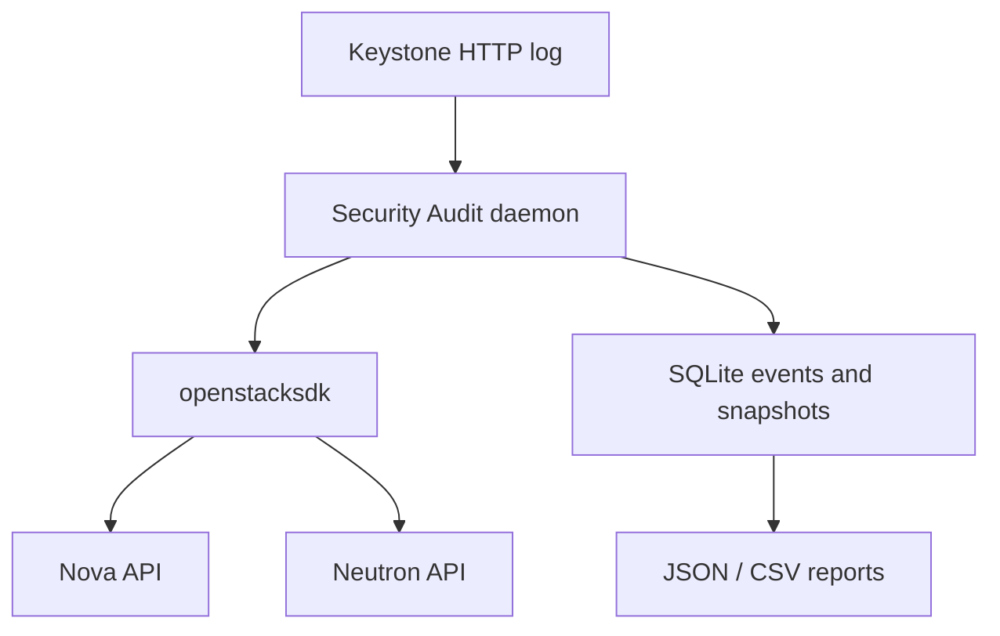

# OpenStack Security Audit Plugin

Plugin universitario per monitorare eventi di sicurezza in un cloud OpenStack.
Integra **Nova**, **Neutron** e **Keystone**, conserva gli eventi in SQLite e
genera report JSON o CSV.

## Funzioni

- rilevamento di creazione, modifica, eliminazione e cambio di stato delle istanze;
- rilevamento di creazione, eliminazione e modifica delle security group e regole;
- rilevamento opzionale di autenticazioni Keystone riuscite e fallite;
- baseline iniziale per non classificare le risorse gia presenti come nuove;
- logging su file e journal systemd;
- report riepilogativi JSON/CSV;
- isolamento in virtual environment e servizio systemd con hardening di base.

## Architettura



Il collector interroga periodicamente le API e confronta lo stato corrente con
lo snapshot persistito. Questa scelta rende il progetto semplice da installare
su DevStack e indipendente dal message broker. Gli accessi Keystone sono letti
incrementalmente dal log HTTP, memorizzando inode e offset per evitare duplicati.

## Struttura del progetto

```text
openstack-security-audit/
|-- security_audit/       # package Python: CLI, collector, DB e report
|-- tests/                # test unitari con client OpenStack simulati
|-- devstack/             # hook plugin.sh e impostazioni DevStack
|-- etc/                  # configurazione, systemd, logrotate e clouds.yaml
|-- tools/                # installazione manuale e smoke test end-to-end
|-- docs/                 # appunti tecnici per presentazione orale
|-- pyproject.toml        # backend di build Python
|-- setup.cfg             # metadata, dipendenze, entry point e regole PEP8
|-- requirements.txt
|-- test-requirements.txt
`-- README.md
```

## Installazione rapida su DevStack esistente

Prerequisiti: uno stack funzionante e `/etc/openstack/clouds.yaml` con una entry
`devstack-admin`. Dalla directory clonata:

```bash
chmod +x tools/*.sh devstack/plugin.sh
./tools/install.sh
```

Controllare il nome del cloud e il percorso del log in:

```bash
sudo nano /etc/security-audit/security-audit.conf
sudo systemctl restart openstack-security-audit
```

Verifica:

```bash
sudo -u security-audit /opt/security-audit/venv/bin/openstack-security-audit \
  --config /etc/security-audit/security-audit.conf check
sudo systemctl status openstack-security-audit
sudo journalctl -u openstack-security-audit -f
```

Se il file Apache non e leggibile dall'utente del servizio, assegnare al gruppo
`security-audit` il solo accesso in lettura tramite ACL:

```bash
sudo setfacl -m g:security-audit:rx /var/log/apache2
sudo setfacl -m g:security-audit:r /var/log/apache2/keystone_access.log
sudo setfacl -m d:g:security-audit:r /var/log/apache2
```

Il percorso effettivo dipende dalla configurazione Apache. Trovarlo con:

```bash
sudo grep -R "CustomLog" /etc/apache2/sites-enabled /etc/apache2/conf-enabled
```

Se Keystone non ha un log dedicato, indicare il log che contiene le richieste
`/v3/auth/tokens`, oppure lasciare vuoto `keystone_access_log`.

Per un'installazione non DevStack, copiare `etc/clouds.yaml.example` nel path
standard dell'utente di servizio, sostituire URL e credenziali e applicare
permessi `0600`. Python 3.10 o successivo e richiesto.

## Installazione durante `stack.sh`

Inserire in `/opt/stack/devstack/local.conf`, adattando l'URL Git:

```ini
[[local|localrc]]
enable_plugin security-audit https://github.com/USER/openstack-security-audit.git main
enable_service security-audit
```

Poi eseguire:

```bash
cd /opt/stack/devstack
./stack.sh
```

DevStack richiama `devstack/plugin.sh` nelle fasi `install`, `post-config` ed
`extra`. `unstack.sh` arresta il servizio; `clean.sh` rimuove codice e unit file.

## Test

Test unitari, senza un cloud reale:

```bash
python3 -m venv .venv
. .venv/bin/activate
pip install -e . -r test-requirements.txt
flake8 security_audit tests
pytest -v --cov=security_audit
```

Test end-to-end su DevStack, dopo aver caricato le credenziali admin:

```bash
source /opt/stack/devstack/openrc admin admin
./tools/smoke_test.sh
```

Lo script crea un'istanza CirrOS e una security group, esegue il collector,
elimina le risorse e genera un report. Usare nomi di image, flavor e network
diversi nello script se DevStack non espone `cirros`, `m1.tiny` e `private`.

## Comandi

```bash
openstack-security-audit --config FILE init-db
openstack-security-audit --config FILE check
openstack-security-audit --config FILE collect-once
openstack-security-audit --config FILE daemon
openstack-security-audit --config FILE list-events --service neutron
openstack-security-audit --config FILE report --hours 24 --format json
```

## Limiti

- Il polling puo non osservare una risorsa creata e cancellata tra due cicli.
- Nova e Neutron non espongono sempre l'autore dell'ultima modifica tramite le
  API di elenco; l'evento conserva `user_id` quando presente.
- Il parser Keystone identifica come attore l'indirizzo remoto del log HTTP.
- SQLite e adatto a un progetto didattico o singolo nodo, non a grandi deployment.
- Per produzione si userebbero notifiche Oslo/Ceilometer e middleware CADF,
  trasporto RabbitMQ e un database centralizzato.

La spiegazione tecnica per l'orale e in [docs/technical-notes.md](docs/technical-notes.md).
